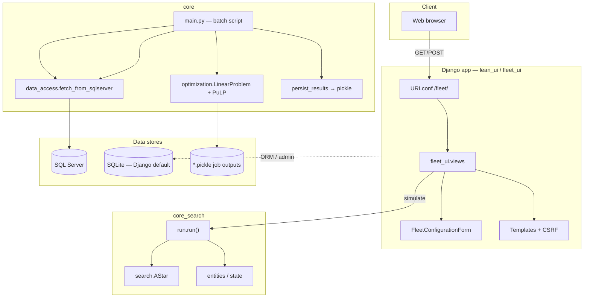

# RouteOptimizer

Fleet and route optimization for mining operations: an **A-star-based dispatch simulator** exposed through a small **Django** UI, plus a separate **batch pipeline** that pulls haul data from **SQL Server** and solves **mixed-integer linear programs (MILP)** with **PuLP**.

## Scenario files

Mines are described in a versioned JSON format (units: tons, hours, minutes).
See [`docs/scenario-format.md`](docs/scenario-format.md). A published sample is
[`samples/toy_mine.json`](samples/toy_mine.json).

```python
from core.scenario import load_scenario_file

scenario = load_scenario_file("samples/toy_mine.json")
```

## Command-line tools

Install the package (PuLP/CBC only — no commercial solver license):

```bash
pip install route-optimizer
# or from a clone: pip install .
# editable: pip install -e .
```

Interactive demo: [Hugging Face Space](https://huggingface.co/spaces/albones80/route-optimizer-demo) · [Colab](https://colab.research.google.com/github/AlfonsoALIO/RouteOptimizer/blob/master/notebooks/route_optimizer_demo.ipynb).

```bash
route-optimizer dispatch samples/tiny_feasible.json -o out/dispatch.json
route-optimizer shift-plan samples/tiny_feasible.json -o out/shift_plan.json
```

Also available as `route-optimizer-dispatch` and `route-optimizer-shift-plan`.
These commands read a local scenario file, write a JSON result, and do not call
SQL Server or the network.

Optional time cap (both commands): `--time-limit SECONDS`.

## Docker

Build an image tagged with the package version from `pyproject.toml`:

```bash
./scripts/build_docker.sh
# → route-optimizer:0.1.0 (and :latest)
```

Mount a host folder and run with networking disabled:

```bash
mkdir -p out
docker run --rm --network=none \
  -v "$PWD/samples:/data/samples:ro" \
  -v "$PWD/out:/data/out" \
  route-optimizer:0.1.0 \
  dispatch /data/samples/tiny_feasible.json -o /data/out/dispatch.json --segments 8 --trucks 2

docker run --rm --network=none \
  -v "$PWD/samples:/data/samples:ro" \
  -v "$PWD/out:/data/out" \
  route-optimizer:0.1.0 \
  shift-plan /data/samples/tiny_feasible.json -o /data/out/shift_plan.json --segments 4
```

The image entrypoint is `route-optimizer`; no database or outbound network is required at run time.

## Hugging Face

The Hub snapshot lives in [`huggingface/`](huggingface/): README, the learned
dispatch-policy checkpoint, sample scenarios, and the scenario format. Publish with a
write token:

```bash
export HF_TOKEN=...   # write access (your HF user, not the GitHub org name)
./scripts/publish_huggingface.sh
# default repo: https://huggingface.co/<your-hf-username>/route-optimizer
# override: HF_REPO_ID=my-org/route-optimizer ./scripts/publish_huggingface.sh
```

Refresh the snapshot from the repo’s samples/docs anytime with
`./scripts/sync_huggingface.sh`. Rebuild the Hub demo GIF/PNGs with
`python scripts/build_hub_assets.py` (included on publish).

Synthetic scenario dataset (generated mines plus the published samples):

```bash
python scripts/generate_synthetic_scenarios.py
export HF_TOKEN=...
./scripts/publish_huggingface_dataset.sh
# → https://huggingface.co/datasets/<your-hf-username>/route-optimizer-scenarios
```

## License

This project is released under the **MIT License**. See [`LICENSE`](LICENSE) for the full text. Package metadata in [`pyproject.toml`](pyproject.toml) declares the same license.

**Rights:** Alfonso Bonillas / [alioit.com](https://www.alioit.com/route-optimizer) hold the rights to this codebase and confirm authority to release it under the MIT License. Runtime dependency licenses and MIT compatibility are recorded in [`DEPENDENCY_LICENSES.md`](DEPENDENCY_LICENSES.md).

## Architecture

High-level view of how the pieces connect:



**Two execution paths**

| Path | Entry | Role |
|------|--------|------|
| **Interactive UI** | `lean_ui/manage.py` → `/fleet/` | User submits segment/truck counts; `core_search.run.run()` runs A* over a toy mine graph and returns step text to the template. |
| **Batch LP** | `core/main.py` (run from repo root with `PYTHONPATH` set) | Loads production-style rows from SQL Server, builds per-arc MILP subproblems, solves with PuLP, writes pickle files per job name. |

The UI path does **not** call `core/main.py` or SQL Server today; the batch path does **not** serve HTTP.

## Repository layout

| Path | Purpose |
|------|---------|
| `core/` | Shared types (`Parameters`, `ProblemResults`), `data_access` (pyodbc), `optimization` (PuLP). |
| `core_search/` | Mine graph model, fleet state, A\* search — used by the Django app. |
| `lean_ui/` | Django project: `fleet_ui` app, templates, SQLite for Django’s own DB. |
| `env_file.py` | Loads repo-root `.env` into `os.environ` (no extra dependency). |
| `.env.example` | Template for secrets and config — copy to `.env`. |

## Requirements

- Python 3 and a virtual environment (recommended).
- **Django UI**: dependencies in `lean_ui/requirements.txt` (includes Django, pandas, numpy, PuLP, pyodbc, etc.).
- **SQL Server batch script**: ODBC driver (e.g. “ODBC Driver 13/17 for SQL Server”) and network access to the database.
- **Environment**: see `.env.example`. Never commit `.env`.

## Setup

1. Clone the repo and create a venv:

   ```bash
   cd RouteOptimizer
   python3 -m venv .venv
   source .venv/bin/activate   # Windows: .venv\Scripts\activate
   pip install -r lean_ui/requirements.txt
   ```

2. Configure environment variables (repo root):

   ```bash
   cp .env.example .env
   # Set DJANGO_SECRET_KEY (required), e.g.:
   # python3 -c "import secrets; print(secrets.token_urlsafe(50))"
   # For local dev UI, set DJANGO_DEBUG=true
   ```

3. **Run the fleet UI** — the Python path must include the **repository root** so `import core_search` resolves:

   ```bash
   cd lean_ui
   export PYTHONPATH="$(dirname "$(pwd)")"   # parent = repo root
   export DJANGO_SECRET_KEY="your-secret-here"
   export DJANGO_DEBUG=true                    # optional, local dev
   python manage.py migrate
   python manage.py runserver
   ```

   Open **http://127.0.0.1:8000/fleet/** (not the site root).

4. **Run the batch LP pipeline** (after setting `SQLSERVER_*` in `.env`):

   ```bash
   cd RouteOptimizer
   export PYTHONPATH="$(pwd)"
   python -m core.main
   ```

## Background and research

The optimization problem aims to **minimize truck trips** subject to tonnage demand, assignment continuity, resident/queued fleet at destinations, and total fleet size.

For more context and research:

- [ResearchGate — Alfonso Bonillas](https://www.researchgate.net/profile/Alfonso_Bonillas)
- [Collective Intelligence for Fleet Optimization in Mines](https://www.researchgate.net/project/Collective-Intelligence-for-Fleet-Optimization-in-Mines)

Work on this project is credited to **Alfonso Bonillas** and [alioit.com/route-optimizer](https://www.alioit.com/route-optimizer). The simulator has been exercised with sample data from a mid-size gold operation (~100k oz/year). Contributions and questions are welcome via [alioit.com](https://www.alioit.com/route-optimizer).
