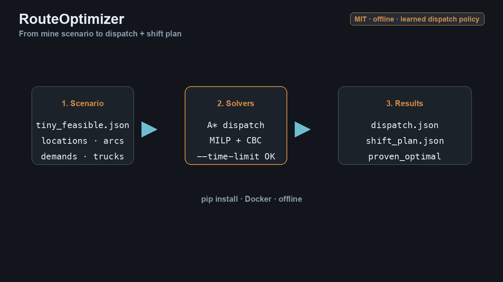
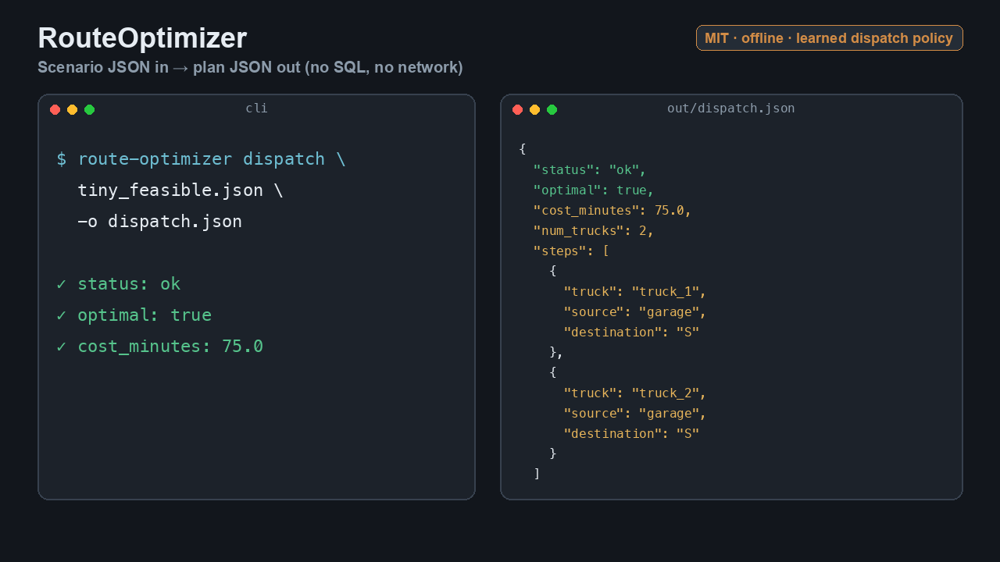

# RouteOptimizer

<p align="center">
  
</p>

<p align="center">
  
</p>

This repository has two parts:

1. **Dispatch policy** — a small neural network in [`dispatch_policy/`](dispatch_policy/)
   (13 → 16 → 8 → 1). It was trained to imitate the A\* solver’s choice among
   legal dispatch actions on synthetic mines. On a held-out set it picks the
   solver’s action about **91%** of the time (a demand-greedy baseline is about **56%**).
   The checkpoint does not prove a plan is optimal.
2. **Operations-research solvers** — A\* dispatch and a PuLP/CBC shift plan, which
   still produce the proven plans. Sample scenarios and the file format are included
   so you can run those solvers offline.

There is no haul-history model and no claim that the network replaces the solver.

Rights: Alfonso Bonillas / [alioit.com](https://www.alioit.com/route-optimizer). License: **MIT**
([`LICENSE`](LICENSE)).

## Trained weights

| File | Role |
|------|------|
| [`dispatch_policy/weights.npz`](dispatch_policy/weights.npz) | NumPy checkpoint (layer matrices `W0`…`W2`, biases, feature mean/std) |
| [`dispatch_policy/config.json`](dispatch_policy/config.json) | Architecture, feature names, holdout accuracy |

```python
from route_optimizer.policy import load_policy

policy = load_policy()  # packaged checkpoint, or pass a path to weights.npz
action = policy.choose(state)  # highest-scoring legal action
```

Teacher: A\* on synthetic format-v1 scenarios. License: MIT.

## What it does

- **Dispatch policy** — ranks the legal moves at a fleet state.
- **Dispatch (A\*)** — builds a truck movement plan over a shift horizon from a
  scenario file.
- **Shift plan (MILP)** — solves a mine-wide truck-flow plan with **PuLP + CBC**
  (open-source; no commercial solver license).

Both tools read local JSON scenarios and write JSON results. They do **not** call
SQL Server or the network at run time.

## What it does not do

- It does **not** train or serve ML models.
- It does **not** include production haul databases or live telematics.
- It does **not** require Gurobi, CPLEX, or other commercial solvers.
- A second anonymized haul-history sample is **not** published until the data
  owner approves release.

## Install

### pip package

```bash
pip install route-optimizer
```

Interactive demo: [Hugging Face Space](https://huggingface.co/spaces/albones80/route-optimizer-demo) ·
[Colab notebook](https://colab.research.google.com/github/AlfonsoALIO/RouteOptimizer/blob/master/notebooks/route_optimizer_demo.ipynb).

Console scripts: `route-optimizer`, `route-optimizer-dispatch`,
`route-optimizer-shift-plan`.

### Docker image

Build from the same repository (image tag matches the package version in
`pyproject.toml`, currently `0.1.0`):

```bash
git clone https://github.com/AlfonsoALIO/RouteOptimizer.git
cd RouteOptimizer
./scripts/build_docker.sh
# → route-optimizer:0.1.0
```

Run with a mounted folder and networking disabled:

```bash
docker run --rm --network=none \
  -v "$PWD/samples:/data/samples:ro" \
  -v "$PWD/out:/data/out" \
  route-optimizer:0.1.0 \
  dispatch /data/samples/tiny_feasible.json -o /data/out/dispatch.json --segments 8 --trucks 2
```

## Scenario file format

See [`docs/scenario-format.md`](docs/scenario-format.md) (format version `"1"`).
Units: tons, hours, minutes.

## Sample scenarios

| File | Role |
|------|------|
| [`samples/tiny_feasible.json`](samples/tiny_feasible.json) | Small mine; **dispatch and shift-plan** both succeed quickly |
| [`samples/toy_mine.json`](samples/toy_mine.json) | Larger synthetic toy mine used by the in-repo fixture (dispatch) |

```bash
# pip — end-to-end on the small sample
route-optimizer dispatch samples/tiny_feasible.json -o out/dispatch.json --segments 8 --trucks 2
route-optimizer shift-plan samples/tiny_feasible.json -o out/shift_plan.json --segments 4

# optional wall-clock cap
route-optimizer dispatch samples/toy_mine.json -o out/toy_dispatch.json --segments 58 --trucks 21 --time-limit 60
```

## Links

| Resource | URL |
|----------|-----|
| Source / pip install | https://github.com/AlfonsoALIO/RouteOptimizer |
| Docker build script | https://github.com/AlfonsoALIO/RouteOptimizer/blob/master/scripts/build_docker.sh |
| Scenario format | [`docs/scenario-format.md`](docs/scenario-format.md) |
| Synthetic scenarios (dataset) | https://huggingface.co/datasets/albones80/route-optimizer-scenarios |
| License | [`LICENSE`](LICENSE) (MIT) |
| alioit.com | https://www.alioit.com/route-optimizer |

## Citation / credit

RouteOptimizer — Alfonso Bonillas / alioit.com — MIT License.
